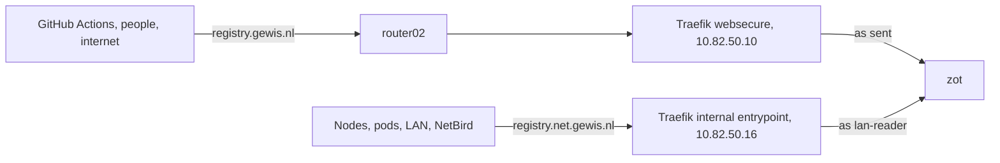

# Two names, one instance

zot grants nothing anonymously: every request must come from a logged-in
identity. The public name passes everything to zot, apart from the guards in
[Sessions and keys](sessions.md), and the LAN name logs every request in as the
read-only user `lan-reader`, see [LAN login](lan-login.md). Both names resolve
through public DNS.

| Name | Public DNS | Entrypoint | Route in `flux/50_apps/zot/ingressroute.yaml` | Serves |
| --- | --- | --- | --- | --- |
| `registry.gewis.nl` | CNAME onto router02 | `websecure`, `10.82.50.10` | `zot` | without an `Authorization` header: everything, the UI included; with one: everything but `/zot/auth/apikey`, without sessions |
| `registry.net.gewis.nl` | CNAME onto `internal.net.gewis.nl`, A `10.82.50.16` | `internal`, `10.82.50.16` | `zot-lan` | `GET` and `HEAD` under `/v2/`, as `lan-reader`, without sessions |

The `internal` entrypoint and its LoadBalancer Service `traefik-internal` come
from the Traefik chart and serve every internal-only route, see
[Ingress](../cluster/traefik.md#internal-only-routes-use-the-internal-entrypoint).
router02 forwards public `:443` only to `10.82.50.10`, so the internet cannot
reach `.16`.

## Which name to use

| For | Name |
| --- | --- |
| pushes, `docker login`, CI | `registry.gewis.nl` |
| the UI, the Keycloak login, API keys | `https://registry.gewis.nl` |
| `image:` in workloads | `registry.net.gewis.nl` |

Both names serve the same images. Workloads must use the LAN name: nodes have
no registry credentials, and `registry.gewis.nl` refuses them.

Both records come from external-dns' route source: `zot` targets router02 like
every other public route, and `zot-lan` targets `internal.net.gewis.nl`
like every internal one. That name's A record comes from the `traefik-internal`
Service, see [DNS](../cluster/dns.md). The registry's LAN CNAME thus ends at
a LAN address, as `kube.gewis.nl` does; only the LAN and NetBird peers with the
`10.82.50.0/24` route reach it. The name is in the default certificate, see
[Certificates](../cluster/certificates.md): the `*.gewis.nl` wildcard covers
one label only.

## Clients

Both entrypoints serve the default Let's Encrypt certificate, so containerd
needs no extra CA and workloads need no `imagePullSecrets`.

On `registry.gewis.nl`, `/v2/` answers `401` with a Bearer challenge, so
`docker pull` there needs a `docker login` first.
